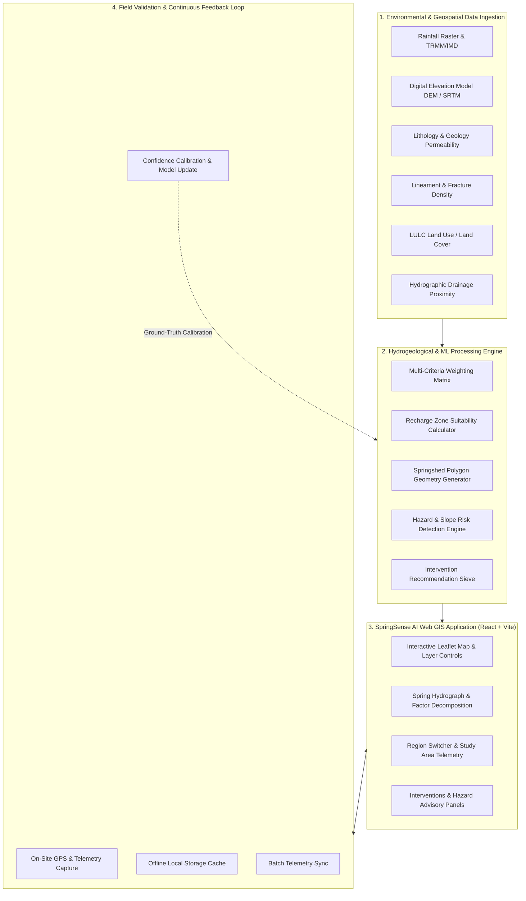
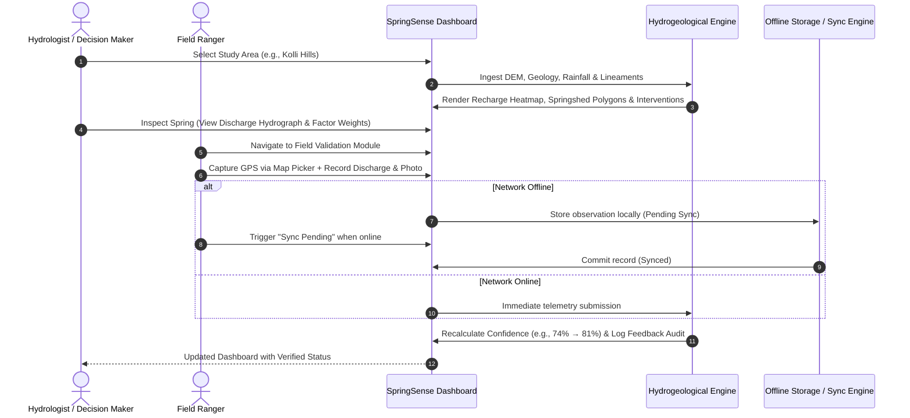

# 💧 SpringSense AI

**AI-Based Hydrogeological Spring Revival & Recharge Planning Decision Support System for Tribal Regions**  
*Developed for Smart India Hackathon (SIH 2026)*

---

## 📌 Table of Contents
- [Executive Overview](#-executive-overview)
- [Problem Statement & The Challenge](#-problem-statement--the-challenge)
- [The Solution: SpringSense AI](#-the-solution-springsense-ai)
- [Key Features & Capabilities](#-key-features--capabilities)
- [System Architecture](#-system-architecture)
- [Workflow & Data Flow](#-workflow--data-flow)
- [Tech Stack & Dependencies](#-tech-stack--dependencies)
- [Multi-Region Study Areas](#-multi-region-study-areas)
- [Project Structure](#-project-structure)
- [Getting Started & Running Commands](#-getting-started--running-commands)
- [Field Validation & Feedback Calibration](#-field-validation--feedback-calibration)
- [Future Roadmap](#-future-roadmap)

---

## 🌐 Executive Overview

**SpringSense AI** is an intelligent, geospatial Decision Support System (DSS) designed to address water scarcity in remote highland and tribal communities across India. By fusing hydrogeological parameters, multi-spectral environmental data, and predictive machine learning models, SpringSense AI delineates mountain springshed recharge zones, prioritizes high-impact civil recharge interventions (such as check dams, recharge pits, and contour trenches), flags geo-hazard risk zones, and provides offline-ready field telemetry verification.

---

## 🛑 Problem Statement & The Challenge

Highland and tribal communities across the Eastern and Western Ghats (e.g., Kolli Hills, Araku Valley, Nilgiris) depend on natural perennial mountain springs (*jhars*, *dharas*, or seeps) for drinking water, domestic supply, and terrace agriculture.

### Key Pain Points:
1. **Critical Spring Depletion:** Erratic rainfall patterns, deforestation, and topsoil degradation have caused perennial springs to become seasonal or dry up entirely.
2. **Lack of Scientific Catchment Mapping:** Springsheds (the subterranean recharge areas feeding a spring) often do not align with surface topographical watersheds, leading to poorly sited water harvesting structures.
3. **Hazardous Interventions:** Constructing unengineered structures on steep slopes (> 38°) triggers slope instability, debris flows, and landslides.
4. **Remote Field Disconnect:** Rural forest rangers and hydrology teams face poor network connectivity, preventing real-time GPS telemetry logging and validation.
5. **No Model Calibration Loop:** Traditional hydrogeological assessments are static one-time surveys without continuous feedback from ground-truth field data.

---

## 💡 The Solution: SpringSense AI

SpringSense AI bridges advanced hydrogeology and field execution with an end-to-end digital platform:

* **Predictive Recharge Zonation:** Computes multi-parametric recharge suitability scores (0–100) using rainfall, DEM slope, rock permeability, fracture lineament density, land cover infiltration, and drainage proximity.
* **Springshed Catchment Delineation:** Automatically projects dynamic catchment polygons for each spring based on elevation and hydrogeological factors.
* **Intelligent Intervention Engine:** Analyzes slope and drainage channels to recommend prioritized civil structures (Check Dams, Recharge Pits, Contour Trenches).
* **Geo-Hazard Risk Detection:** Identifies steep, unstable slopes (> 38°–40°) and provides safety recommendations (*"Avoid or Verify before construction"*).
* **Offline-First Field Validation:** Equips field personnel to capture on-site GPS coordinates, discharge measurements (L/min), photos, and field notes with local caching and one-click cloud synchronization.
* **Continuous Feedback Loop:** Ground-truth field observations automatically update model confidence and calibrate future predictions.

---

## 🌟 Key Features & Capabilities

| Module | Features & Capabilities |
| :--- | :--- |
| **Interactive GIS Map** | Full Leaflet integration, layer toggling (Suitability Grid, Springsheds, Interventions, Hazard Zones), confidence threshold filtering, dynamic zoom & pan. |
| **Spring Hydrograph & Factor Explainability** | Real-time 6-month discharge hydrograph trends (Recharts) and factor breakdown bar charts showing why a specific recharge score was assigned. |
| **Multi-Region Support** | Instant switching between key tribal study areas (Kolli Hills, Araku Valley, Nilgiris Foothills) with region-specific geology, elevation, and tribal community profiles. |
| **Ranked Intervention Planning** | Candidate recharge structures scored by terrain suitability, upstream drainage alignment, and target spring revival impact. |
| **Field Verification App** | Map GPS coordinate picker, camera photo attachment, discharge logger, offline caching (`localStorage`), and batch sync. |
| **Feedback Audit Trail** | Live audit log showcasing baseline vs. calibrated confidence scores and verified status updates. |

---

## 🏗️ System Architecture



---

## 🔄 Workflow & Data Flow



---

## 🛠️ Tech Stack & Dependencies

### **Core Frontend & Framework**
* **[React 19](https://react.dev/)** — Component-driven reactive UI architecture.
* **[Vite 8](https://vitejs.dev/)** — Next-generation frontend tooling and lightning-fast dev server.
* **JavaScript (ES Modules)** & **TypeScript Definition Support** — Modern module resolution.

### **Geospatial & Mapping**
* **[Leaflet (v1.9.4)](https://leafletjs.com/)** — Mobile-friendly interactive mapping library.
* **[React-Leaflet (v5.0.0)](https://react-leaflet.js.org/)** — React wrapper for Leaflet components (TileLayer, CircleMarker, Polygon, Rectangle, Tooltip).
* **OpenStreetMap Tiles** — High-resolution global base map layer.

### **Data Visualization & Analytics**
* **[Recharts (v3.10.1)](https://recharts.org/)** — Declarative charting library for discharge hydrograph time-series and environmental factor breakdown bar charts.

### **Design System & Icons**
* **[Lucide React](https://lucide.dev/)** — Clean iconography (`Droplets`, `Layers`, `ShieldAlert`, `CheckCircle2`, `Compass`, `MapPin`, `RefreshCw`, `AlertTriangle`).
* **Vanilla CSS (Design Tokens)** — Custom glassmorphic cards, responsive panels, status pill badges, and accessible color palettes.

---

## 🗺️ Multi-Region Study Areas

SpringSense AI comes pre-configured with curated hydrogeological data across 3 key highland regions:

| Study Region | State & District | Elevation Range | Predominant Geology | Target Tribal Community |
| :--- | :--- | :--- | :--- | :--- |
| **Kolli Hills** | Namakkal, Tamil Nadu | 950m – 1,380m MSL | Charnockite & Gneiss | Malayali Tribal Community |
| **Araku Valley** | Alluri Sitharama Raju, Andhra Pradesh | 900m – 1,400m MSL | Khondalite & Quartzite | Konda Dora & Bagata Tribes |
| **Nilgiris Foothills** | The Nilgiris, Tamil Nadu | 1,200m – 2,100m MSL | Charnockite & Granulites | Toda, Kota & Kurumba Tribes |

---

## 📂 Project Structure

```text
Springsense-Ai/
├── index.html               # Main HTML entry point with Google Fonts & Leaflet styles
├── package.json             # NPM dependencies, scripts, and project metadata
├── vite.config.js           # Vite build configuration with React plugin
├── tsconfig.json            # TypeScript configuration
├── public/                  # Static assets
└── src/
    ├── main.jsx             # React DOM root entry point
    ├── App.jsx              # Core Application component (Map, Tabs, Controls, State)
    ├── index.css            # Design System styling, variables, layout, and UI themes
    ├── data/
    │   └── syntheticData.js # Hydrogeological calculation engine, region datasets & weights
    └── assets/              # Icons and multimedia resources
```

---

## 🚀 Getting Started & Running Commands

### Prerequisites
* **Node.js** (`v18.0.0` or higher recommended)
* **npm** (`v9.0.0` or higher)

### 1. Clone the Repository
```bash
git clone https://github.com/Bharath454/SpringSense-AI.git
cd SpringSense-AI
```

### 2. Install Dependencies
```bash
npm install
```

### 3. Start the Local Development Server
```bash
npm run dev
```
> The application will start locally. Open your browser and navigate to the displayed URL (typically `http://localhost:5173`).

### 4. Build for Production
```bash
npm run build
```
> Generates an optimized production bundle in the `dist/` directory.

### 5. Preview Production Build
```bash
npm run preview
```

---

## 📱 Field Validation & Feedback Calibration

1. **Location Selection:** Switch between study areas using the header dropdown.
2. **Dashboard Overview:** Filter GIS map layers, inspect KPI metrics, and adjust the **Minimum Confidence Threshold** slider.
3. **Spring Deep-Dive:** Click on any spring marker to review measured discharge, elevation, rock lithology, 6-month hydrograph, and weighted factor breakdown.
4. **Interventions & Hazards:** Review ranked recharge sites (Check Dams, Recharge Pits) and steep-slope hazard alerts.
5. **Ground-Truth Logging:**
   - Go to the **Field Validation** tab.
   - Toggle **Offline Mode** if testing in disconnected zones.
   - Click **Use Map Location** to select precise coordinates.
   - Enter measured discharge (L/min), upload a site photo, and submit.
   - Click **Sync Pending** to simulate field-to-cloud batch sync.
6. **Audit Trail:** View the **Feedback Loop** tab to see real-time model confidence score improvements.

---

## 🔮 Future Roadmap

- [ ] **Satellite Ingestion Pipeline:** Automated ingestion of Sentinel-2 NDRE/NDVI vegetation indices and Sentinel-1 SAR soil moisture data.
- [ ] **IoT Sensor Integration:** Real-time telemetry integration with LoRaWAN ultrasonic flow meters at spring discharge points.
- [ ] **Machine Learning Training Pipeline:** Python backend API (`FastAPI` + `GeoPandas` + `XGBoost`) for dynamic raster geo-inference.
- [ ] **Multi-Lingual Support:** Vernacular language interfaces (Tamil, Telugu, Hindi) for local community water security teams.

---

## 📄 License & Acknowledgments

* **Smart India Hackathon (SIH 2026)** Prototype Submission.
* Built with 💙 for tribal highland water security and ecological spring revival.
